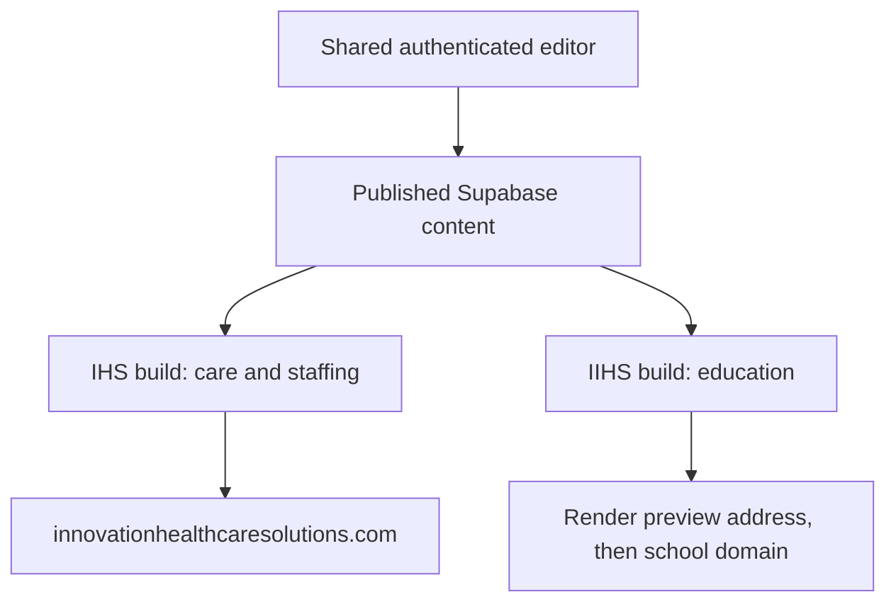

# IHS and IIHS website plan

IHS serves home care clients and healthcare employers. IIHS serves students and organizations seeking healthcare education. Each has a separate Render Static Site, logo, homepage, navigation, and contact journey.

## Architecture

Reuse React, existing courses, Supabase, and the editor API. Select the audience at build time with `VITE_SITE_VARIANT=ihs|school`. Build IHS into `dist` and IIHS into `dist-school`. Retain the existing school homepage `home` keys and store care homepage copy under `ihsHome`. Existing course and service blocks retain their keys.

Keep the school homepage close to the original composition. Give the healthcare homepage its own wide photo hero, warm gold accents, audience links, equal-height icon service cards, and a separate staffing feature. Both retain purple branding, rounded cards, sticky navigation, and Motion entrance/hover animations. Subtle light passes play once on selected images and panels and respect reduced-motion preferences.

Play the logo intro once per document load. Navigation between pages does not replay it; a full browser reload can.

The graduate testimonial section is removed because the source contains hard-coded quotes and names without supporting attribution. Add testimonials only after the team supplies verified quotes and permission to publish them.

The shared database and editor permissions remain in place. Editors can edit both sites. Separate organization ownership requires a later authorization design.

The existing inline homepage, course, and service controls are reused, and publishing supports both configured deploy hooks. Contact introductions have separate editable keys for IHS and IIHS; student resources and the healthcare education page also have editable introductions. Other contact content, the admissions guide, and the remaining resource content still need editing controls. Live two-site sign-in and publishing require the manual hosting/auth configuration before end-to-end verification.

The healthcare education page remains an introduction with program summaries, application access, student portal access, and admissions support. Once the school origin is configured, it links to school program details. Old course and admissions routes redirect to their corresponding school paths. Student resources includes a prominent link back to the configured healthcare origin.

Both contact pages reuse the original animated contact layout. The message panel stays below the navigation while scrolling on desktop and returns to normal page flow on phones. Short desktop viewports allow scrolling within the panel so all fields remain accessible. The old form's simulated success behavior is replaced with an email draft; server-side message delivery is not connected. Visitors must send the prepared message in their email app.

## Development phases

1. Add audience configuration, independent builds, fixed brand headers/footers, and two homepages. Reuse `Services` on IHS and `Courses`/`CourseDetail` on IIHS.
2. Add the seven-step How to Apply page, supplied infographic, existing Populi links, audience-specific contact pages, and student portal access.
3. Extend editor publishing to attempt both Render deploy hooks and report individual failures. Add the school service to `ihcs-editor-api/render.yaml`.
4. Add approved program content, faculty, partnerships, Digital Learning, and news/events after confirming content and scope.
5. Configure the school preview URL, review both sites, then connect the purchased domain. Add permanent education redirects, canonical URLs, sitemap entries, and verified metadata. Complete the editor walkthrough.

## First-phase verification

- Build both audiences and run TypeScript/lint checks.
- Review branding, navigation, contact links, admissions, and mobile layouts.
- Keep old education links usable through an IHS gateway until the school URL is configured; then preserve their program path on IIHS.
- Verify that publishing attempts both configured hooks and reports partial failures.
- Keep unconfirmed Practical Nursing dates, approvals, tuition, and proposed programs out of public course data.

## Development status

The audience builds, branded homepages/navigation, admissions guide, student portal links, education gateway, Render service definitions, and dual publish-hook support are implemented locally. The original homepage, header, footer, and motion are restored and adapted for both audiences. The course-page payment-state and icon lint issues are fixed. Both production builds and full frontend lint pass. API type checks and publish-hook tests pass.

Desktop browser review confirms the restored homepages, school program navigation, and admissions guide. The browser viewport override did not apply, so phone-width verification remains a launch check. Live editor authentication, real deploy hooks, Render provisioning, DNS, and permanent redirects still need verification. Next-start labels recalculate from existing schedules instead of retaining stale snapshot dates. Program content still needs owner confirmation under IIHS branding.

## Content and launch dependencies

Available: both October 9 logos, website blueprint, application infographic, existing course data/site assets, and Populi application/portal URLs.

Planned domain: `innovationinstituteofhealthcaresolutions.com`; not purchased. Needed: actual school Render URL; official IIHS contact details; mission/leadership content; confirmed active program list, pricing, schedules, and requirements; Practical Nursing status documentation, curriculum, admissions, and policies; partnership materials and digital checkout links.

The proposed January 2027 Practical Nursing cohort and November 2, 2026 application opening require confirmation. Additional application, payment, registration, event, or LMS systems need a defined scope. This phase links to existing systems.

## Build and deployment

In `IHCS-REACT_SITE_REDESIGN`, run `npm run dev` for IHS or `npm run dev:school` for IIHS. Run `npm run build:ihs` or `npm run build:school` for production artifacts.

Set `VITE_SCHOOL_SITE_URL` on IHS after Render assigns the school URL. Set `VITE_IHS_SITE_URL` on IIHS to the care domain. Configure existing editor/Supabase public variables on both services. Add both origins to `ALLOWED_ORIGINS` and Supabase auth redirect URLs. Set server-side `RENDER_DEPLOY_HOOK_URL` for IHS and `RENDER_SCHOOL_DEPLOY_HOOK_URL` for IIHS.

Before cutover, confirm auth callbacks, both hooks, live content, contact links, deep links, and redirects. Retain the preceding deploy and published content snapshot for rollback. Local development does not create Render services or update DNS.

The user manages Render, Supabase configuration, and domain setup. Follow [the manual Render setup guide](render-setup.md); the agent continues local implementation and verification.
